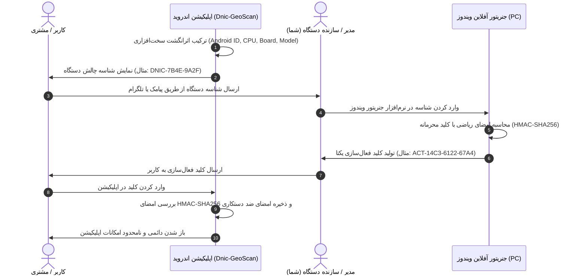

# 🔐 راهنمای جامع معماری، فعال‌سازی و غیرفعال‌سازی سیستم لایسنس آفلاین Dnic-GeoScan

این سند راهنمای رسمی توسعه‌دهنده برای مدیریت ماژول لایسنس سخت‌افزاری آفلاین (Offline Cryptographic Challenge-Response Licensing) در پروژه **Dnic-GeoScan** است.

---

## ۱. نحوه فعال‌سازی یا غیرفعال‌سازی لایسنس در کد برنامه (۱ ثانیه)

برای راحتی توسعه و ارائه آپدیت‌های سریع به تسترها یا کاربران بدون نیاز به وارد کردن کد، یک سوییچ سراسری (Master Switch) در نظر گرفته شده است:

📁 **مسیر فایل در پروژه:**
`app/src/main/java/com/denic/geoscan/data/license/LicenseManager.kt`

```kotlin
object LicenseManager {
    /**
     * سوئیچ اصلی اعتبارسنجی لایسنس:
     * - مقدار false: قفل لایسنس موقتاً غیرفعال است و برنامه مستقیم باز می‌شود (حالت فعلی برای آپدیت‌های سریع).
     * - مقدار true: لایسنس سخت‌افزاری کاملاً فعال شده و کاربر تا کد صحیح را وارد نکند وارد برنامه نمی‌شود.
     */
    const val IS_LICENSE_ENFORCEMENT_ENABLED = false // <--- تغییر به true جهت فعال‌سازی مجدد در نسخه نهایی تجاری
```

### وضعیت فعلی (نسخه v2.2.0 به بعد):
- مقدار `IS_LICENSE_ENFORCEMENT_ENABLED = false` تنظیم شده است.
- برنامه مستقیماً وارد هاب و محیط آنالیز محلی / اسکن ریموت می‌شود.
- در صفحه تنظیمات (Settings) نشان `UNLOCKED (DEV MODE)` نمایش داده می‌شود.
- تمامی کدهای تولید شناسه سخت‌افزاری و الگوریتم‌های رمزنگاری فعال هستند تا برنامه‌نویس بتواند در هر زمان کد چالش دستگاه را در صفحه تنظیمات مشاهده کند.

---

## ۲. ساختار و نحوه کار الگوریتم چالش-پاسخ (Challenge-Response)

سیستم لایسنس کاملاً آفلاین کار می‌کند و نیازی به اینترنت، سرور یا پیامک خودکار ندارد:



### اجزای اصلی:
1. **شناسه چالش دستگاه (Device Challenge):**
   - فرمت: `DNIC-XXXX-YYYY` (طول ۱۴ کاراکتر با خط تیره، بسیار خوانا و بدون ابهام برای تایپ).
   - مبنا: هش SHA-256 از ترکیب سخت‌افزاری `Android ID + Manufacturer + Model + Hardware + Board`.
2. **کلید فعال‌سازی (Activation Key):**
   - فرمت: `ACT-XXXX-YYYY-ZZZZ` (طول ۱۸ کاراکتر با خط تیره).
   - مبنا: امضای HMAC-SHA256 شناسه نرمال‌شده با سالت محرمانه تجاری.
3. **کلید اضطراری مستر (Master Emergency Key):**
   - مقدار: `DNIC-MASTER-2026-GEO-UNLOCKED`
   - کاربرد: جهت تست‌های توسعه‌دهنده در شرایطی که لایسنس فعال باشد ولی جنریتور در دسترس نباشد.

---

## ۳. راهنمای کار با برنامه جنریتور ویندوز (Windows License Generator)

نرم‌افزار تولید لایسنس بر روی کامپیوتر شما در مسیر زیر ذخیره شده است:
📂 `C:\Users\arfaghani\Desktop\Dnic_License_Generator\`

> [!IMPORTANT]
> این پوشه کاملاً محرمانه است و در فایل `.gitignore` پروژه قرار داده شده است تا هرگز کلیدها و جنریتورها وارد گیت‌هاب نشوند.

### نحوه استفاده:
1. پوشه `Dnic_License_Generator` را باز کنید.
2. روی فایل **`DnicLicenseGenerator.bat`** دابل کلیک کنید.
3. یک رابط کاربری مدرن، تاریک و سریع باز می‌شود:
   - کد چالش کاربر (مثلاً `DNIC-7B4E-9A2F`) را در کادر وارد کنید.
   - دکمه **«تولید آنی کلید فعال‌سازی»** را بزنید.
   - کد فعال‌سازی (مثلاً `ACT-14C3-6122-67A4`) بلافاصله تولید می‌شود.
   - می‌توانید از دکمه **«کپی متن کامل پیام برای تلگرام/واتساپ»** استفاده کنید تا متن آماده راهنما همراه با کد برای ارسال به مشتری آماده شود.
4. روش جایگزین خط فرمانی:
   - در پاورشل ویندوز:
     ```powershell
     .\GenerateLicense.ps1 -DeviceChallenge "DNIC-7B4E-9A2F"
     ```

---

## ۴. امنیت و پایداری لایسنس

1. **امضای ضد دستکاری (Anti-Tamper Signature):**
   اگر کاربری دستگاه خود را روت کند و بخواهد با ویرایش فایل XML دیتابیس `SharedPreferences` پرچم `is_app_activated` را دستی `true` کند، اپلیکیشن امضای یکپارچگی `computeAntiTamperSignature` را بررسی کرده و در صورت عدم تطابق با شناسه سخت‌افزاری، فعال‌سازی را باطل می‌کند.
2. **عدم وابستگی به شبکه:**
   اپلیکیشن ۱۰۰٪ آفلاین است و هیچ ترافیک شبکه‌ای برای استعلام لایسنس مصرف نمی‌کند.
3. **مستقل بودن از تغییر رام سبک:**
   شناسه سخت‌افزاری بر پایه پارامترهای فیزیکی بورد دستگاه ساخته می‌شود و در طول به‌روزرسانی‌های عادی اندروید تغییر نمی‌کند.
